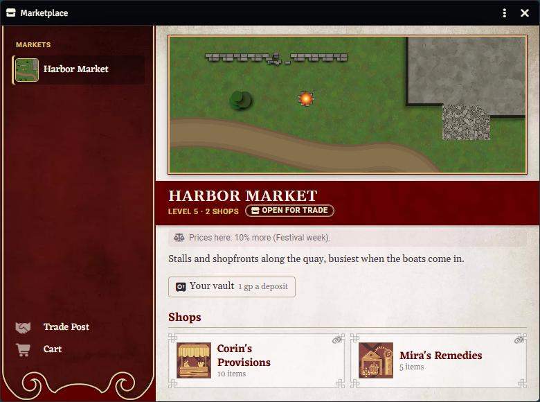
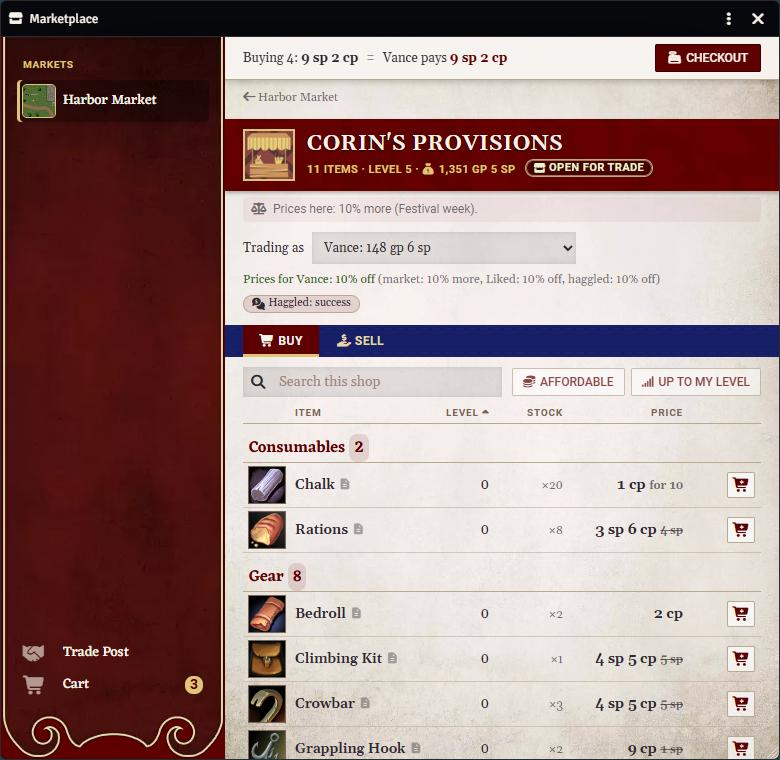
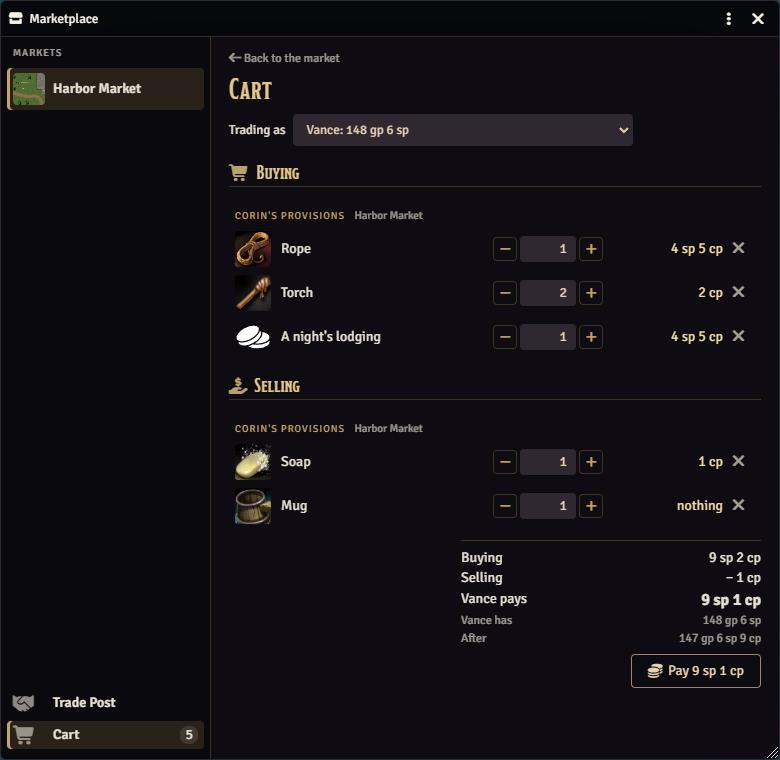
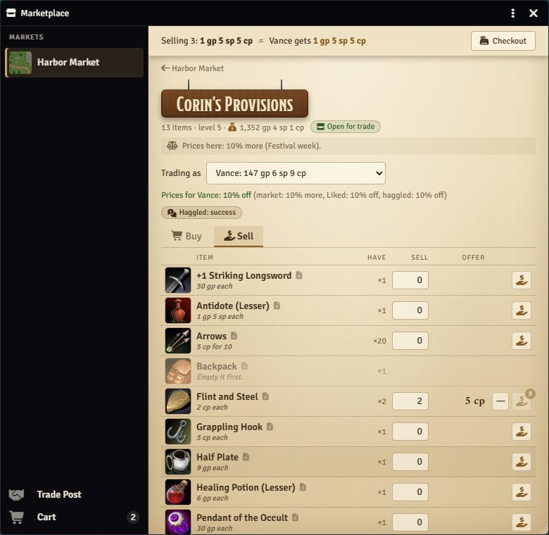
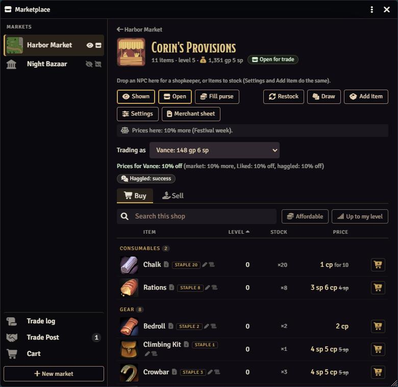

# PF2e Marketplace

A marketplace window for Pathfinder 2e on Foundry VTT 14. The GM sets up markets (a town's market district, a bazaar, a trading post) with their shops, and players browse them, fill a cart, buy and sell, all without opening a merchant sheet. Shops are the system's own merchants (loot actors with their sheet set to Merchant), so every shop keeps working as a normal merchant sheet if the module is turned off. No other modules are needed.

The full [guide](docs/guide.md) covers everything; this page is the short version.

## What it looks like



**A market**, in the Pathfinder sheet look: its picture, description and shops.



**A shop.** The tally of the cart at the top, the purse in the header, and stock by group with level, rarity, stock and price. The line beside Trading as says what makes up this character's prices.



**The cart**, in the Dark look: what the character buys and sells, by shop, and what they pay or get.



**Selling**, in the Dark and parchment look: what the character carries and the shop's offer for each.



**The GM's view of a shop**: Shown, Open, Fill purse, Restock, Draw, Add item, Settings, and each item's place in the stock.

## Install

In Foundry, go to **Add-on Modules**, then **Install Module**, and paste this into **Manifest URL**:

```
https://github.com/Sir-Bayard/pf2e-marketplace/releases/latest/download/module.json
```

Foundry's **Update** button then picks up each new release. You can also download `module.zip` from the [latest release](https://github.com/Sir-Bayard/pf2e-marketplace/releases/latest) and unzip it into `Data/modules/pf2e-marketplace`.

Requires Foundry VTT 14 (verified on 14.370) and the Pathfinder Second Edition system (verified on 8.7.0). No other modules.

## In short

**Open it** with **Marketplace** at the top of the Actors tab, or a hotkey you set. Players can also double-click a merchant's linked token. The window's menu has three looks (Dark, Dark and parchment, Pathfinder sheet) and the sheet look's color. Everything works from the keyboard.

**For the GM:**

- **Markets** hold shops: every merchant in the market's folder, plus any you add. Each market is **Visible** (players browse it) and **Open** (players trade there), and can change all its prices (a festival), follow a reputation in [PF2e Campaign Trackers](https://github.com/Sir-Bayard/pf2e-campaign-trackers), and keep a **vault** for each character.
- **Shops** have a purse (the merchant's coins), a shopkeeper whose attitude sets prices (with [PF2e NPC Attitudes](https://github.com/Sir-Bayard/pf2e-npc-attitudes) if you use it), what they pay for goods, and **services** (lodging, a crossing). A kind of shop, or another shop's settings, starts one off.
- **Stock** is staples that come back on every restock, rotating stock drawn from the system's compendium by lines you choose ("Some Weapons, up to uncommon"), and what players sold. Restocks run when you say, or every so many days of game time.
- **Formulas** can be sold instead of items, priced by item level.
- The **trade log** keeps every trade, and a **receipt** goes to chat.
- Links like `@Shop[id]` in a journal open a shop.

**For players:**

- Pick a market and a shop, choose who's trading, and add goods and services to one **cart**, sorted and filtered as you like. A shop's **Sell** tab puts what you sell into the same cart; at each shop only the difference changes hands, and one button makes the whole trade.
- **Haggle** once per shop between restocks, with Diplomacy against the DC for the shop's level.
- The **Trade Post** is for trading between characters: offers and requests that another player accepts.

A GM has to be logged in for any trade. Two numbers come from the PF2e system itself rather than the module (the party treasure by level, for purses and formula prices, and the DCs by level, for haggling); if a system update moves them, the GM is told and the features that need them switch off until the module catches up.

## Settings and API

The settings (stock line sizes, purse size, formula multiples, attitude price changes, haggling, receipts, opening shops from tokens) and the API (`open`, `markets`, `trades`) are in the [guide](docs/guide.md#settings).

## Changes

See [CHANGELOG.md](CHANGELOG.md).

## How it was made

This module was written with Claude, Anthropic's AI assistant, directed and tested by its author at a real table. It is shared as is, for free.

## Problems and suggestions

Open an [issue](https://github.com/Sir-Bayard/pf2e-marketplace/issues).

## License

[MIT](LICENSE). Copyright (c) 2026 Sir Bayard.

## Pathfinder

PF2e Marketplace is an unofficial, free module for the Pathfinder Second Edition system on Foundry VTT. It is not published, endorsed or specifically approved by Paizo Inc. Pathfinder is a trademark of Paizo Inc., used here only to say which game the module works with. The module follows the game's rules, which Paizo publishes under the ORC License, and refers to them by name; it doesn't reproduce Paizo's rules text, art or setting material.
