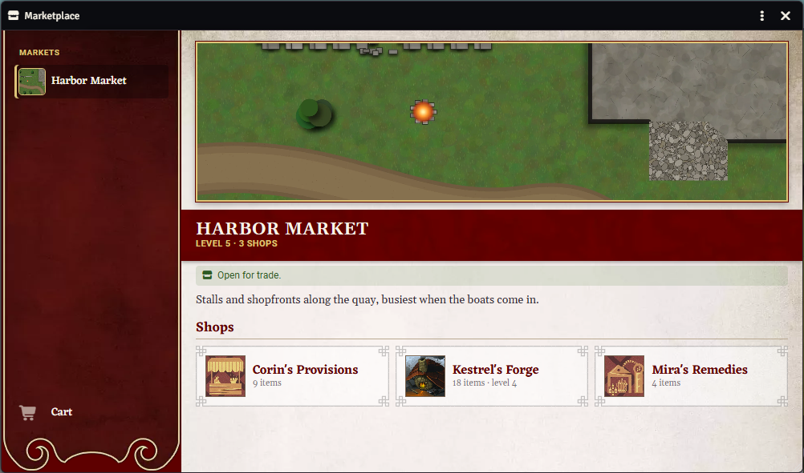
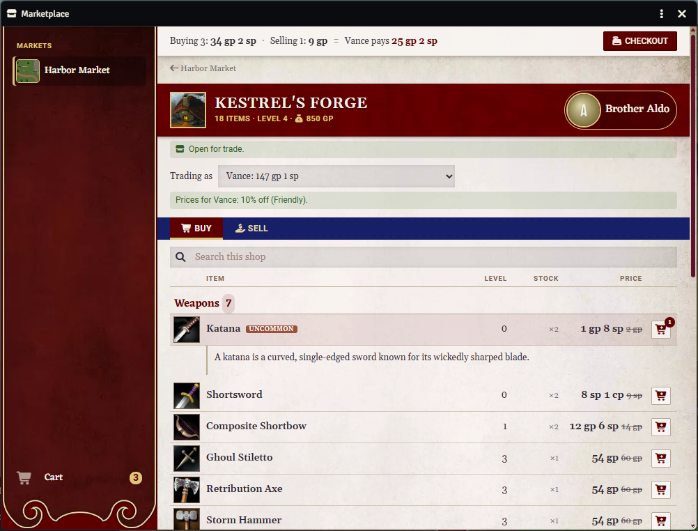
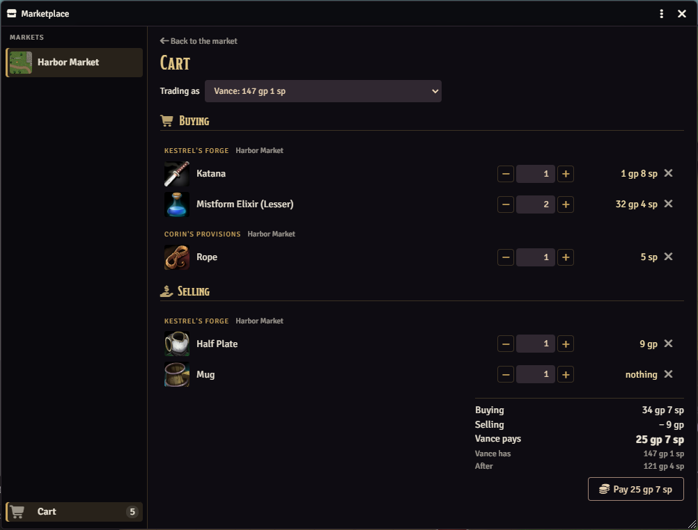
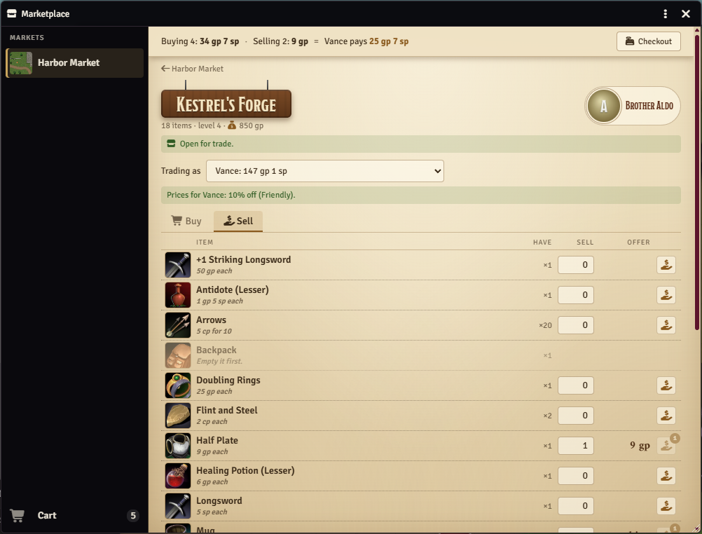
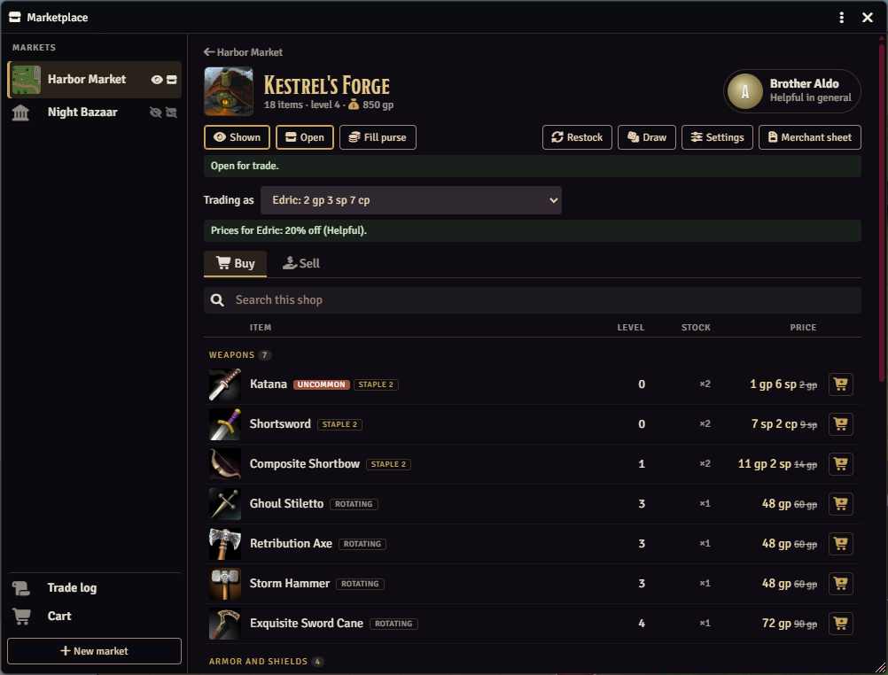

# PF2e Marketplace

A marketplace window for Pathfinder 2e on Foundry VTT 14. The GM sets up markets (a town's market district, a bazaar, a trading post) with their shops, and players browse them, fill a cart, buy and sell, all without opening a merchant sheet. Shops are the system's own merchants (loot actors with their sheet set to Merchant), so every shop keeps working as a normal merchant sheet if the module is turned off. No other modules are needed.

## What it looks like



**A market.** Its picture and description, and its shops. Players see the markets the GM has made visible, and can trade where the GM has opened them.



**A shop.** Stock by group with level, rarity, stock and price, and descriptions on a click. This shopkeeper is friendly toward Vance, so his prices are 10% off.



**The cart.** What the character buys and sells, by shop, and what they pay or get. The GM's client makes the trade.



**Selling.** What the character carries and the shop's offer for each. Offers go into the same cart as purchases.



**The GM's view of a shop.** Shown or Hidden, Open or Closed, the purse, Fill purse, the shop's settings and its shopkeeper.

## Install

In Foundry, go to **Add-on Modules**, then **Install Module**, and paste this into **Manifest URL**:

```
https://github.com/Sir-Bayard/pf2e-marketplace/releases/latest/download/module.json
```

Foundry's **Update** button then picks up each new release. You can also download `module.zip` from the [latest release](https://github.com/Sir-Bayard/pf2e-marketplace/releases/latest) and unzip it into `Data/modules/pf2e-marketplace`.

Requires Foundry VTT 14 (verified on 14.370) and the Pathfinder Second Edition system. No other modules.

## Opening it

Click **Marketplace** at the top of the Actors tab. There's also a hotkey with no key set (**Open the Marketplace** in **Configure Controls**). The window remembers its size and place in each browser.

The window's menu (⋮ in its title bar) has three looks, each user's own choice, remembered in their browser: **Dark**; **Dark and parchment**, with markets and shops on parchment; and **Pathfinder sheet**, drawn with the system's own character sheet art (its parchment, red sidebar and frames).

## For the GM

### Markets

**New market** asks for a name, a picture, a level, a merchant folder and a description. Every PF2e merchant in the market's folder, and in the folders inside it, is one of its shops; pick an existing Actor folder or let the module make one named after the market. To add a merchant from elsewhere, drag it from the Actors tab onto the market; the small x on its card takes it out again (the merchant itself stays). **Edit** changes all of this later, and **Delete** removes the market but leaves its merchants and folder alone.

Two switches on each market decide what players get:

- **Visible**: players see the market and can browse its shops, for planning.
- **Open**: players can buy and sell there. Opening a market makes it visible; hiding it closes it.

A market starts hidden and closed.

### Shops

**New shop** makes a PF2e merchant in the market's folder, at the market's level, with a full purse, and opens its sheet so you can drag in its stock from the compendium. Any merchant you already have works too: put it in the folder.

On a shop's page:

- **Shown / Hidden**: a hidden shop doesn't appear to players even in a visible market (a fence, a back room).
- **Open / Closed**: players can browse a closed shop but not trade there, even in an open market (closed for the night, sold out until the caravan comes). The market's own switches come first: players can't trade anywhere in a closed market.
- **The purse** is the merchant's own coins, the money buyers pay in and the money it pays for what players sell. **Fill purse** tops it up to one level's party treasure for the shop's level (GM Core's table; 100 gp below level 1). It only adds coins, never takes any away, and you can always change the coins on the sheet.
- **Settings**: the shop's level (at 0 it takes its market's), whether it buys from players, what it pays (50% of an item's price and 100% of treasure's value by default), an unlimited purse for a shop that never runs out, how many restocks it keeps what players sold, its rotating stock lines (see Stock and restocks) and its attitude (see below).
- **Merchant sheet** opens the PF2e sheet.

Shops sell identified goods: an item put in a shop unidentified is identified there.

### Stock and restocks

Each item in a shop is one of three kinds, shown to you on its line (click the mark to swap staple and rotating):

- **Staples** come back to their number on every restock (right-click the mark to set it). Anything you drag into a shop is a staple, and a staple that sells out stays on the list as sold out.
- **Rotating** stock is cleared on a restock and drawn again.
- **Sold** items are what players sold the shop. They're for sale at full price and stay for two restocks by default (gone at the second; a shop setting), so selling the day before market day still leaves a chance to buy back.

Stock a shop had before version 0.2 becomes staples of what it has, the first time a GM loads the world.

A shop's **Settings** take its rotating stock lines, such as "Some Weapons", "Few Scrolls" or "4 Potions and oils", from 18 ready filters, each common only, up to uncommon or up to rare. Few, Some, Many and Lots draw a number in a range (1-3, 3-6, 6-10, 10-20 by default; module settings). Items are drawn from the system's compendium up to the shop's level, most of them near that level; consumables (not wands), bombs and ammunition come in stacks of one to four (a setting); scrolls and some wands get a random spell of a rank that fits. Nothing the shop already stocks is drawn again (for scrolls and wands, the same spell); Draw adds to what's there, a restock replaces the rotating stock.

- **Draw** shows a draw from the lines to look over, with Draw again, and adds it as rotating stock.
- **Restock** puts staples back, clears and redraws rotating stock, counts sold items down and fills the purse; you can skip the draw or keep sold items that once. **Restock all** on a market does every shop.
- A market can **restock every so many days** of game time (Edit): when that much time has passed on the world clock, every shop restocks once, however long it's been. Restock all starts the count again.

While a shop is browse only, players see its staples, plus the rest of its stock if they saw it open since its last restock ("the stock has changed since your last visit" otherwise).

### Shopkeepers and prices

Drag an NPC onto a shop to make them its shopkeeper; players see their token name and picture. The shopkeeper's attitude changes what players pay when they buy:

| Attitude | Price change |
|---|---|
| Hostile | won't trade |
| Unfriendly | 20% more |
| Indifferent | normal |
| Friendly | 10% off |
| Helpful | 20% off |

These are settings, as is whether hostile shopkeepers trade at all. Treasure (gems, art objects) is never discounted, since shops buy it back at its full value; a markup still applies. Attitude doesn't change what a shop pays, except that a shop never pays a character more for something than it would charge them for it (with a discount of over 50%, say, it pays less than half for goods). With [PF2e NPC Attitudes](https://github.com/Sir-Bayard/pf2e-npc-attitudes) installed, the shopkeeper's attitude there counts, toward each character where you've set one. If the party is shown a different attitude from the true one (a merchant posing as a friend, or Unknown), prices are normal, so a disguise isn't given away and a secretly hostile merchant still trades; your view of the shop says when that's happening. Without NPC Attitudes, or for a shopkeeper with no attitude there, the shop's own attitude setting counts.

### The trade log

**Trade log** (shown only to you) lists every purchase and sale, newest first: who made it, for which character, the shop, what changed hands and for how much. It keeps the last 300. A sale of an item whose price doesn't match its compendium entry (a price edited on the sheet), or that has none (homebrew), is marked there and in your notice, with both prices; runes and materials added to an item don't count, since the system adds them on top of the item's own price.

## For players

Open the **Marketplace**, pick a market and a shop. Click an item for its description; right-click it for its full sheet. **Trading as** chooses which of your characters is shopping (or the party stash, if you own the party); prices are for that character.

**Buying.** Click the cart button on a line to add one, or one batch for things sold in batches (10 arrows), never more than the shop has; right-click it to take one (or one batch) off.

**Selling.** A shop's **Sell** tab lists what your character carries, with the shop's offer for each. Click the offer button on a line to offer one more (or one batch), right-click for one fewer, or type how many. Unidentified items have to be identified first, and containers emptied.

**The cart and checkout.** Purchases and sales go into one cart, from any open shop. The bar at the top of a shop page keeps a running tally (what you're buying, what you're selling, and what you pay or get) with a **Checkout** button that opens the cart. The cart lists everything by shop, with minus and plus buttons for each quantity, and one button makes the whole trade. Sales are settled with purchases: at each shop only the difference changes hands, so selling your old armor can pay for the new, and a shop with an empty purse can still take a trade-in against what you buy from it. The GM's client checks the stock, the prices, your goods and your money, moves the coins (making change from bigger coins as the system does) and the items; what you buy arrives identified and stacked with what you have. If anything changed since you looked, nothing happens and you're told why. If the cart changed after the total you saw (a quantity typed a moment before), the button asks you to look again first.

A GM has to be logged in for any trade: Foundry only lets a GM's client change the merchants. Browsing works without one.

## Privacy

As with everything in Foundry, every actor and every world setting reaches every player's browser. Players don't see hidden markets, hidden shops or GM notes in the window, but a player who opens the browser console can read the markets, every merchant's stock and the trade log. Don't keep real secrets there.

## Settings

- **Pathfinder sheet look: color** (each user, Red): the color of the Pathfinder sheet look: Red, Green, Blue, Purple, Brown or Black.
- **Stock line size: Few, Some, Many, Lots** (world, 1-3, 3-6, 6-10, 10-20): how many a rotating stock line of that size draws.
- **Drawn consumables per stack** (world, 1-4): how many of each consumable, bomb or ammunition a draw gives, in batches.
- **Shop purse size (%)** (world, 100): how full Fill purse and new shops make a purse. Lower it for a poor region, raise it for a rich one.
- **Hostile shopkeepers won't trade** (world, on): off lets them trade at the Hostile price change.
- **Price change** for each attitude (world): in percent, positive costs more, negative is a discount. Buying only; treasure is never discounted.
- **Open the Marketplace** in **Configure Controls**: the hotkey, unset.

## Macros

`game.modules.get("pf2e-marketplace").api`:

- `open(marketId, shopId)`: opens the window, on a market and shop if given.
- `markets()`: the markets as stored.

## Changes

See [CHANGELOG.md](CHANGELOG.md).

## How it was made

This module was written with Claude, Anthropic's AI assistant, directed and tested by its author at a real table. It is shared as is, for free.

## Problems and suggestions

Open an [issue](https://github.com/Sir-Bayard/pf2e-marketplace/issues).

## License

[MIT](LICENSE). Copyright (c) 2026 Sir Bayard.

## Pathfinder

PF2e Marketplace is an unofficial, free module for the Pathfinder Second Edition system on Foundry VTT. It is not published, endorsed or specifically approved by Paizo Inc. Pathfinder is a trademark of Paizo Inc., used here only to say which game the module works with. The module follows the game's rules, which Paizo publishes under the ORC License, and refers to them by name; it doesn't reproduce Paizo's rules text, art or setting material.
